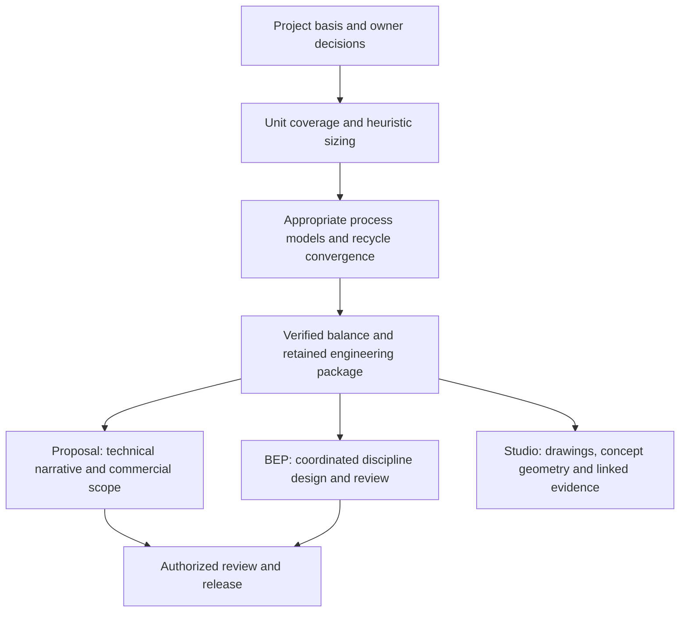
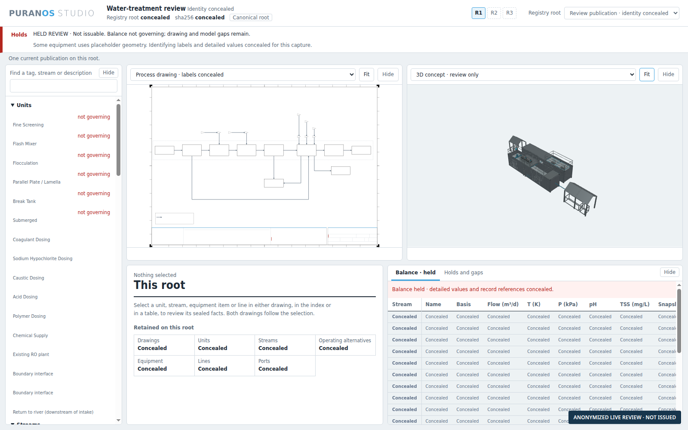

# Puran Water · Engineering that remembers

We provide industrial water, wastewater and waste-to-value process engineering, equipment support and operating investigations. **PuranOS** is the working system behind that service: specialist agents call engineering code, retain the basis and carry reviewed results into the next stage of a project.

[Work with Puran Water](https://puranwater.com/contact/) · [Explore the working system](https://github.com/puran-water/PuranOS-public) · [Try an engineering tool](#public-engineering-tools)

## One engineering basis, from proposal to basic engineering

`/sizing-to-balance` is the engineering core of `/proposal-workflow` and the starting package for `/bep-workflow`. It connects unit coverage, heuristic sizing, appropriate simulation, recycle convergence and whole-plant material and heat accounting. Equipment schedules and drawings read the retained engineering basis. Computed requirements, client-provided values, assumptions and unresolved inputs remain distinguishable.

`/proposal-workflow` carries that basis into a technical proposal and commercial offer for review. `/bep-workflow` starts from its sealed engineering package and coordinates discipline work, checks and the Basic Engineering Package. The owner controls process selections, exceptions and release. These are internal working procedures, described publicly; installing one MCP server does not install the complete workflow.

## PuranOS Studio

Studio brings a retained engineering publication into a browser: process drawings, review-stage concept geometry, equipment properties, sizing basis and supporting lists. Linked selections connect appearances to the same engineering identity. R1 supports the BFD and balance review; R2 carries PFDs and coordinated lists; R3 brings P&IDs, concept geometry and the line list together.

Each publication identifies its source revision and review gate. Studio displays retained evidence; it does not calculate a new design or confer issue authority. Project access is controlled. [Studio and its review model](https://github.com/puran-water/PuranOS-public/blob/main/docs/studio.md).

*Live Studio interface, captured for this overview. Project identifiers and detailed values are concealed. The publication remains a held review with unresolved conditions; it is not an issued design.*

## The specialist team

Process, CAD, civil, piping, mechanical, structural, electrical, automation, EHS and municipal-water roles have separate responsibilities. Separation specialists advise on technologies and vendor evidence; narrative and deliverables specialists turn accepted records into usable documents. Cost estimation, procurement, project management, finance and maintenance connect the engineering to delivery and operations.

The owner coordinates the work, with `pe-process` running the proposal and BEP procedures. The former `pe-lead` persona is retired. Specialist configurations describe responsibilities; access comes from the tools and permissions actually assigned to a run. [Current personas and handoffs](https://github.com/puran-water/PuranOS-public/blob/main/docs/architecture/personas/README.md).

## Public engineering tools

These repositories contain standalone experimental releases and receive scoped updates from the working monorepo. They return numerical results and structured evidence; the calling agent supplies interpretation and reporting.

| Repository | Use it for |
| --- | --- |
| [fluids-mcp](https://github.com/puran-water/fluids-mcp) | Pipe flow, pipe and valve sizing, fluid properties and bounded sweeps. |
| [heat-transfer-mcp](https://github.com/puran-water/heat-transfer-mcp) | Heat exchangers, air cooling, heat loss, insulation and thermal properties. |
| [water-chemistry-mcp](https://github.com/puran-water/water-chemistry-mcp) | PHREEQC speciation, mixing, saturation and chemical-dosing screens. |
| [corrosion-engineering-mcp](https://github.com/puran-water/corrosion-engineering-mcp) | Corrosion chemistry and model-specific screening with applicability limits. |
| [qsdsan-engine-mcp](https://github.com/puran-water/qsdsan-engine-mcp) | Dynamic treatment-process simulation, job state and numerical time series. |
| [watertap-engine-mcp](https://github.com/puran-water/watertap-engine-mcp) | Steady-state flowsheets using WaterTAP, IDAES and Pyomo with solver diagnostics. |
Start with each repository's quick start, MCP client configuration, known issues and licence notices. `v0.1.0` is an immutable initial release; `main` follows reviewed development. Git installs are documented. The public support package is distributed in the [fluids repository](https://github.com/puran-water/fluids-mcp/tree/main/support/puran-mcp-support).

Additional public tools include [AutoCAD/DXF automation](https://github.com/puran-water/autocad-mcp), the [FreeCAD integration fork](https://github.com/puran-water/freecad-mcp), and the [pandid drawing fork](https://github.com/puran-water/pandid). Their own documentation defines their scope, upstream attribution and platform requirements. Archived repositories are historical snapshots, not the current monorepo implementation.

## How real work improves the tools

A workflow exposes a missing check or model limitation. The correction lands in the monorepo and becomes available to later work. The public mirror exports the approved package scope, checks private content, secrets and redistribution rights, then advances the public branch. Pinned project runs retain their earlier code and evidence until a deliberate revision adopts a change.

PuranOS combines open-source libraries with Puran engineering code and, where a workflow needs them, separately licensed tools. The full monorepo, customer records, vendor evidence and internal commercial authority are not part of these public packages. [Architecture, workflows and access](https://github.com/puran-water/PuranOS-public).

Bring a project basis, a calculation you want checked or a workflow your team repeats. [Talk to Puran Water](https://puranwater.com/contact/).
